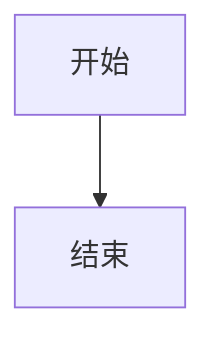

# 鲸鲸阅读器 Full Syntax 样例

本文逐条覆盖 spec §5.7「Markdown 语法支持矩阵」，供人工核对（T10）与 `--verify-render` 自检（T17）使用。
网络图片只写链接、不下载；指向不存在文件的相对图片正好用来核对「图片占位框」。

[TOC]

## 1. GFM 基础语法

### 1.1 标题（ATX 与 Setext）

#### ATX 四级标题

##### ATX 五级标题

###### ATX 六级标题

Setext 一级标题
===============

Setext 二级标题
---------------

### 1.2 段落与强调

普通段落。**加粗**、*斜体*、***加粗斜体***、~~删除线~~、`行内代码`。
同一段落的第二行（软换行，仍在同一段）。

### 1.3 列表

- 无序列表项一二三
  - 嵌套二级
    - 嵌套三级
- 无序列表项四五六

1. 有序列表第一项
2. 有序列表第二项
   1. 嵌套有序第一项
   2. 嵌套有序第二项

### 1.4 任务清单

- [ ] 未完成的任务
- [x] 已完成的任务

### 1.5 表格（含对齐）

| 左对齐 | 居中 | 右对齐 |
|:-------|:----:|-------:|
| 单元格 | 内容 | 1,000 |
| 甲 | 乙 | 丙 |

### 1.6 引用

> 引用第一行
> 引用第二行
>
> > 嵌套引用

### 1.7 围栏代码块与高亮

```js
function greet(name) {
  return `你好，${name}！`;
}
```

```python
def greet(name):
    return f"你好，{name}！"
```

超长代码行（应横向滚动，不撑破布局）：

```js
const veryLongLine = '鲸鲸阅读器-超长代码行-ABCDEFGHIJKLMNOPQRSTUVWXYZ-0123456789-abcdefghijklmnopqrstuvwxyz-ABCDEFGHIJKLMNOPQRSTUVWXYZ-0123456789-abcdefghijklmnopqrstuvwxyz-END';
```

### 1.8 链接与自动链接

[普通链接（外链）](https://example.com)、<https://example.com/auto>。

### 1.9 图片

网络图片（shields.io 徽章；联网正常显示，离线/无 DNS 时换成占位框）：


相对图片（文件不存在，占位框按 16:9）：


### 1.10 分隔线

---

## 2. GFM 附加：标题锚点与页内跳转

每个标题都自动生成锚点 id，页内跳转：[跳到「围栏代码块与高亮」](#17-围栏代码块与高亮)。

## 3. 笔记体扩展语法

### 3.1 YAML front matter

本文档开头的 front matter 默认隐藏，请点开正文顶部的「属性」折叠块查看。

### 3.2 wikilink

- [[笔记甲]]
- [[笔记乙|带别名的笔记]]

### 3.3 附件

- 图片附件（文件不存在，占位框）：![[图片 1.png]]
- 非图片附件（渲染为文件名链接）：![[说明.md]]

### 3.4 高亮

这是 ==高亮文本==，也可以 ==**高亮加粗**==。

### 3.5 注释

可见文字 %%这段注释不渲染%% 可见文字。

%%
多行块注释
整段都不渲染
%%

### 3.6 内联目录

本文档顶部的 `[TOC]` 会就地生成内联目录（见上方）。

## 4. AI README 常见写法

### 4.1 居中容器与徽章

<div align="center">


**鲸鲸阅读器** · <sub>副标题</sub> · <sup>上标</sup>

</div>

### 4.2 原生折叠块

<details>
<summary>点开查看（默认折叠）</summary>

- 折叠块内的 **Markdown** 照常渲染
- 折叠块内的 [链接](https://example.com) 也可点击

</details>

### 4.3 语义标签

按 <kbd>Ctrl</kbd> + <kbd>Shift</kbd> + <kbd>C</kbd> 定位到文件；水分子式 H<sub>2</sub>O；幂运算 2<sup>10</sup>。
断行演示：第一行<br>第二行。

<p align="center">居中段落：<kbd>Esc</kbd> 关闭浮层</p>

### 4.4 图片对齐与尺寸


### 4.5 emoji

直接字符：🚀 🎉 😀　短码：:rocket: :tada: :smile:

### 4.6 代码块超长行

见 1.7 末尾的超长代码行（横向滚动 + 右上角「复制」按钮）。

## 5. 不支持项（按纯文本显示）

### 5.1 数学公式

行内公式：$E = mc^2$；块级公式：

$$
\int_0^1 x^2 dx
$$

### 5.2 Mermaid 代码块



### 5.3 定义列表

术语
: 定义内容（markdown-it 不支持定义列表，按普通段落显示）

### 5.4 HTML script / style / iframe（清洗规则移除）

<script>console.log('应被清洗');</script>
<style>body { color: red; }</style>
<iframe src="https://example.com"></iframe>

## 6. 脚注

鲸鲸阅读器支持脚注[^1]，也支持具名脚注[^note]。

[^1]: 这是第一条脚注。
[^note]: 这是第二条脚注的正文。
